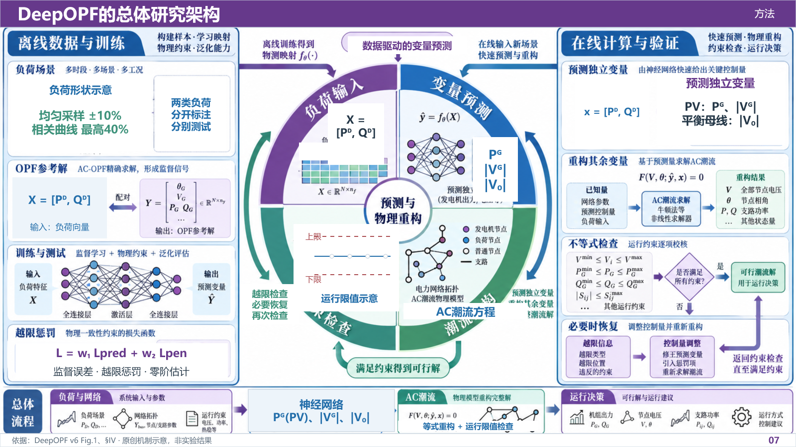
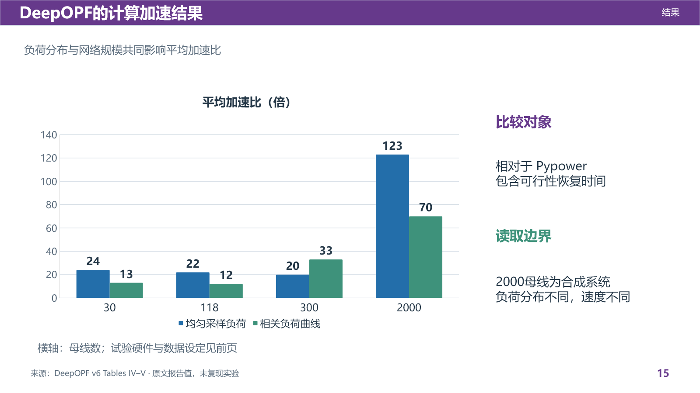
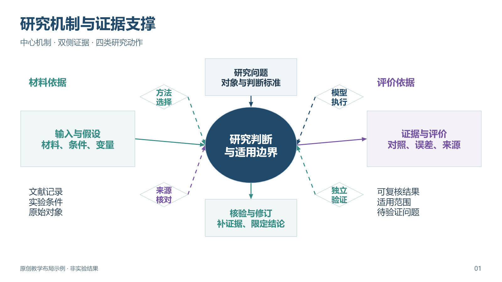
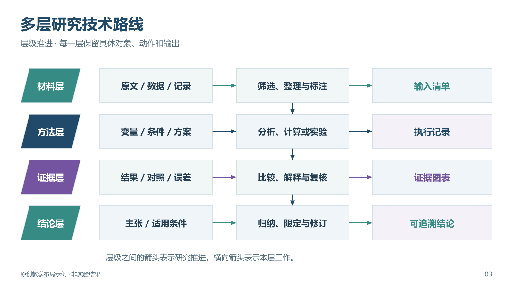
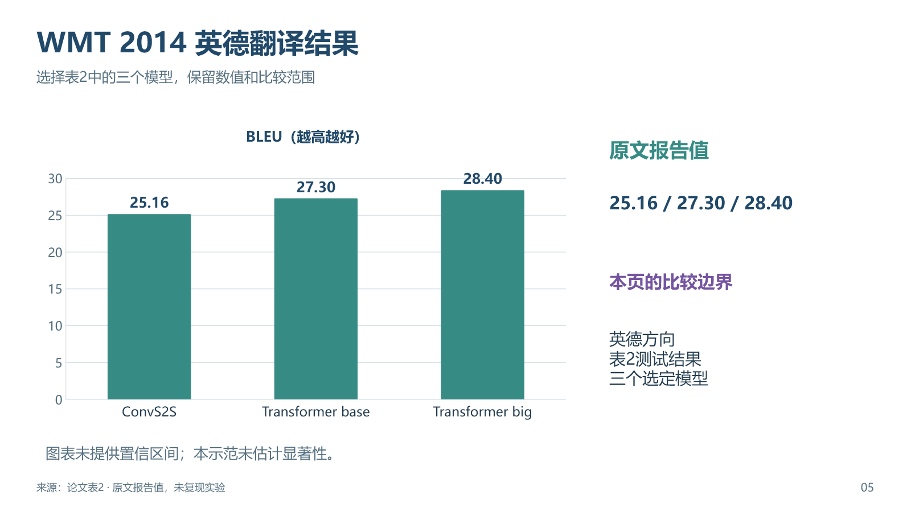

# academic-ppt-skill

面向学术汇报、教学、答辩和组会的 Codex skill。根据最新材料与参考图组织研究逻辑，保留必要解释、具体过程和可追溯证据。支持新建、只审阅、局部修改和科研配图。

## 第三版增加了什么

- **复杂参考图适配**：提炼核心对象、分组、箭头与证据位置，以真实内容重排。
- **可检查的证据对应**：关键主张、来源版本、原文位置和原生图表数据相连。
- **连续修改**：稳定页面与对象标识，检查局部编辑是否波及无关页及关联资源。
- **图片与原生混合制作**：复杂科研图可作为高清图片嵌入；不以全原生对象为由简化参考效果。原生数据图表保留实际数据。
- **完整案例**：20页数据驱动电力系统最优潮流专题，含密集科研图、真实结果、出处和讲稿。
- **故障用例**：检查错数值、漏图表、漏页、乱序、来源缺失和修改范围。

[下载20页DeepOPF案例](examples/deepopf/deepopf-academic-v3.pptx) · [查看案例与证据说明](examples/deepopf/index.md)




## 保留的第二版能力

- **六类可编辑版式**：中心机制、双侧协同、分层路线、实验设计、验证矩阵与结果页。
- **两种信息密度**：相同主线的现场讲解版和独立阅读版。
- **公开论文案例**：六页Transformer阅读示范，含原生结构图、表格、数据图、来源与备注。
- **偏好配置**：本次要求优先于默认值，私人配置不发布。
- **检查加强**：包内链接、私密文件、原生PPT对象、备注和预览一致性；提供可重复的失败用例。

## 直接看样本

[下载8页可编辑样页库](assets/templates/academic-layouts-v2.0.pptx) · [下载6页公开论文示范](examples/transformer/transformer-reading-example-v2.pptx)





全部版式与密度对照见 [图库](assets/gallery/index.md)。论文各页的原文位置与限制见 [案例说明](examples/transformer/index.md)。原版三个SVG样图继续保留。

样页中的12/16/19是教学模拟数据。论文示范中的结果来自原文，**未做训练或实验复现**。结构图是原创简化示意，不能直接作为完整实现图。

## 安装与调用

下载或克隆仓库，将根目录全部内容复制到 `~/.codex/skills/academic-ppt/`，保持 agents、references、assets、examples 和 scripts 的相对位置。Windows默认位于用户目录的 `.codex/skills/academic-ppt/`。重新打开会话后可显式调用 **`$academic-ppt`**。

```text
使用 $academic-ppt，根据最新论文和参考图制作学术PPT。
采用信息充分的科研架构风格，先给方案和代表性样页供我审阅。
```

```text
使用 $academic-ppt，只审阅这份PPT，按页列出问题与具体修改建议，先不要改文件。
```

```text
使用 $academic-ppt，只改第12页技术路线图。
保留其余内容和现有配色，把数据、方法、验证与反馈关系画清楚。
```

长期偏好可复制 [默认配置](assets/preferences/default.json) 为本地 `preferences.local.json`，只改需要的字段；按 [偏好说明](references/preferences-and-density.md) 使用。配置不是脚本，也不会自动执行。新稿可按偏好制作，局部修改先沿用现稿。

## 检查与适用范围

```text
python scripts/check_package.py .
python scripts/check_package.py . --self-test
python scripts/test_audit_deck.py
```

检查脚本只用Python标准库。它验证资源、链接、示例PPTX结构、预览数量与公开包边界，不判断科研结论，也不证明PowerPoint中的操作或投影效果。技能规则的实际试用见 [行为用例](references/behavioral-cases.md)。每次制作仍须读原材料、核对数值并查看最终渲染。

第二版样本已通过文件结构、原生表格与图表检查，并从最终PPTX重新导入渲染后逐页查看。所有页面含讲解备注，正文保留必要理解条件；尚未用Microsoft PowerPoint人工打开验证，不声明全部播放器兼容。

第三版20页案例也已从最终PPTX重新导入渲染并逐页检查，通过OOXML结构校验及证据绑定检查。另用副本验证原生文字、表格与图表修改，以及跨页修订时图表、工作簿和备注同步；18个无关页面保持原样。四张复杂科研主图作为高清图片嵌入，图片内元素整体编辑。具体测试与限制见行为用例。

本技能提供方法与样本，不内置制作引擎；实际输出使用运行环境中的PPT工具。入口是 [SKILL.md](SKILL.md)，内容、视觉和交付规则按需加载。

## 来源与许可

第一版调研了 academic-pptx-skill、easyslides、happy-figure-skill、paper2ppt、plot-is-all-you-need 和 OpenAI skill-creator，借鉴与调整见 [来源说明](references/sources.md)。规则和样本独立制作，没有复制第三方实现或用户提供的宣传截图。

版本：**0.3.0**。原创规则、检查脚本、布局图与示范PPTX以 [MIT许可证](LICENSE) 发布。引用论文仍须注明原作；MIT许可不覆盖第三方原文或图像。本仓库未打包论文原文、作者图像和私人材料。
