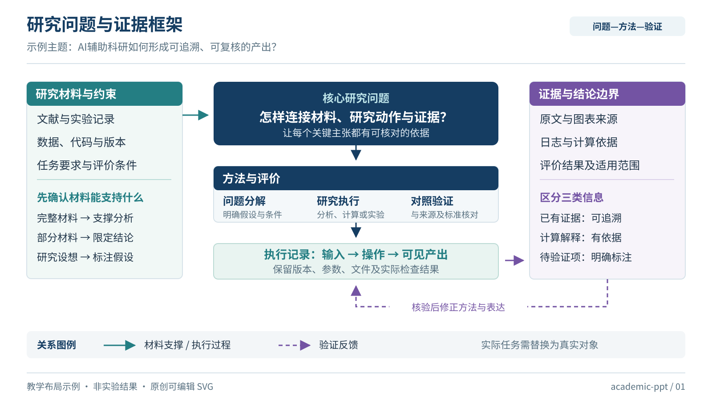
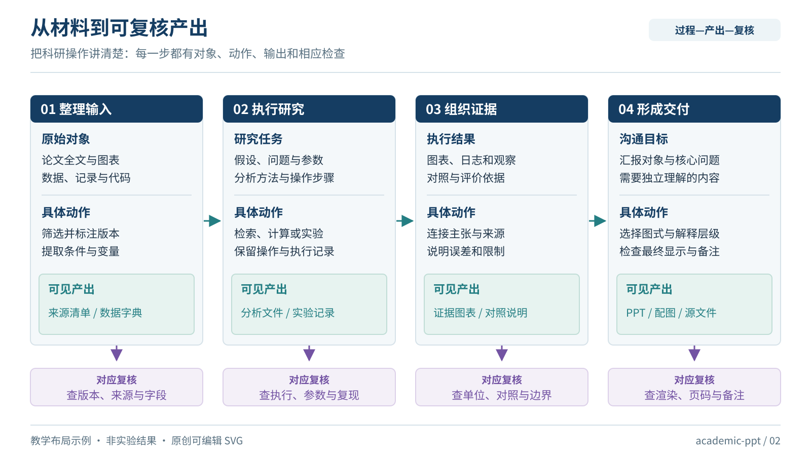
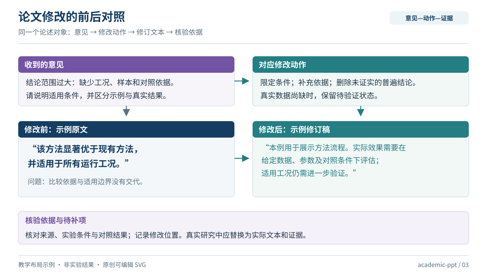

# academic-ppt-skill

一个面向学术汇报、课程教学、答辩和组会的 Codex skill。强调信息充分、页面可独立理解、科研关系清楚、证据可追溯，以及整套PPT的一致性。

它适合喜欢科研架构图、技术路线图和具体操作示例的用户。流程按任务范围变化：**新建、审阅、局部修改、科研配图**，不会把所有请求都扩展成完整PPT。

## 能做什么

- 从最新材料组织研究主线，区分已有证据、计算、假设和待补材料。
- 根据参考图选择流程、中心机制、双侧对照、分层结构、反馈或结果图。
- 保留必要信息，避免所有页面都变成“标题加三个卡片”。
- 需要时先交付方案与代表性样页，认可后继续；沿用已有授权。
- 为完整新稿安排讲解备注，制作后检查实际渲染、图注、字体与页码。

## 三张原创样图

样图是可编辑SVG，帮助选择版式，**不是实际实验结果或现成PPT导出器**。

### 研究问题与证据框架



### 从材料到可复核产出



### 论文修改的前后对照



每张样图的适用场景、配色与调整方法见 [图库说明](assets/gallery/index.md)。

## 安装与使用

下载或克隆本仓库，把仓库根目录的全部内容复制到自己的技能目录 `~/.codex/skills/academic-ppt/`。最终应能找到 `~/.codex/skills/academic-ppt/SKILL.md`；保留 agents、references、assets 和 scripts 的相对位置。Windows 的默认位置为用户目录下的 `.codex/skills/academic-ppt/`。

重新打开会话使客户端发现新技能，也可先用路径直接引用。默认允许自动选择；显式调用名为 **`$academic-ppt`**。

```text
使用 $academic-ppt，根据我的最新材料和这些参考图制作学术PPT。
先给出内容方案与3张代表性样页，我审阅后再完成全稿。
```

```text
使用 $academic-ppt，只审阅这份PPT。
按页指出科学含义、内容逻辑和投影可读性问题，先不要改文件。
```

```text
使用 $academic-ppt，只改第12页技术路线图。
保留现有研究内容和配色，画清数据、方法、验证与反馈关系。
```

## 文件与检查

[SKILL.md](SKILL.md) 是简短入口。按需阅读的内容、视觉、质量规则在 [references](references/content-and-evidence.md)；使用来源见 [借鉴与来源](references/sources.md)。

本地检查技能包的资源完整性与SVG外部依赖：

```text
python scripts/check_package.py .
python scripts/check_package.py . --self-test
```

这些检查不证明生成的PPT可读或科学正确。每次制作仍需核对材料，并查看最终文件的实际渲染。

## 范围与来源

本技能提供制作方法、规则和原创示例，不内置制作引擎，不自带收费服务，也不需要单独API密钥。实际PPT输出取决于运行环境中的工具；缺少工具时应说明限制。

调研并参考了 academic-pptx-skill、easyslides、happy-figure-skill、paper2ppt、plot-is-all-you-need 和 OpenAI skill-creator 的工作思路，具体链接与调整见 [来源说明](references/sources.md)。没有复制第三方实现或用户提供的宣传截图。

版本：0.1.0。原创规则、检查脚本和示例以 [MIT许可证](LICENSE) 发布。
