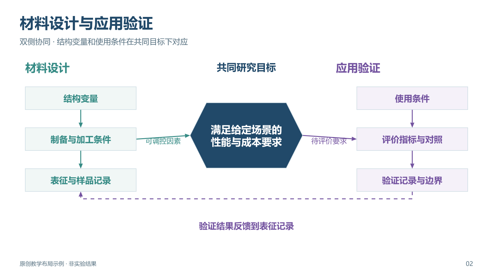
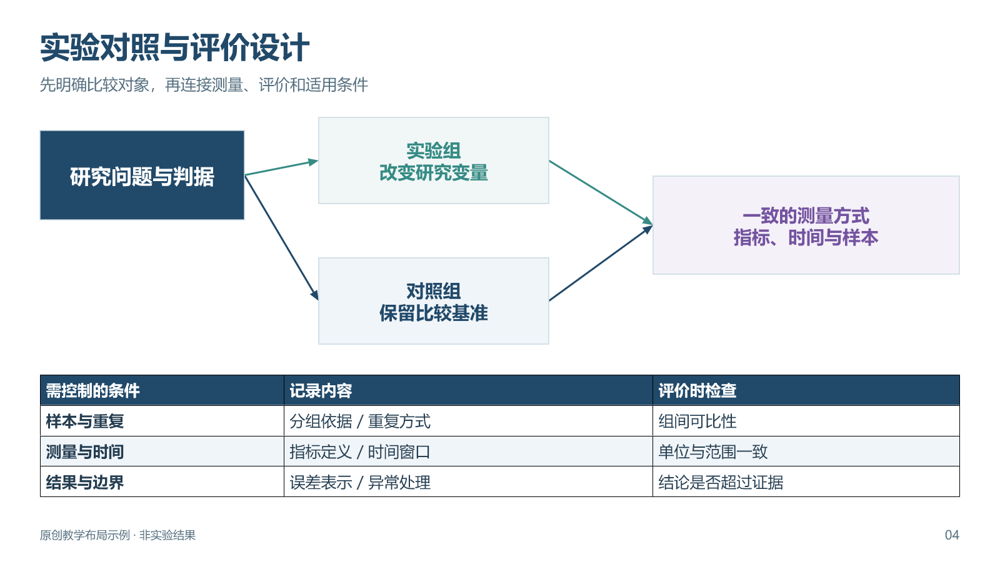
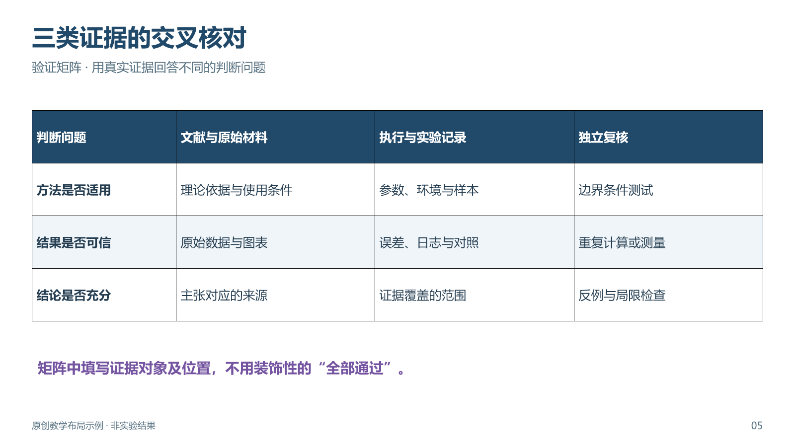
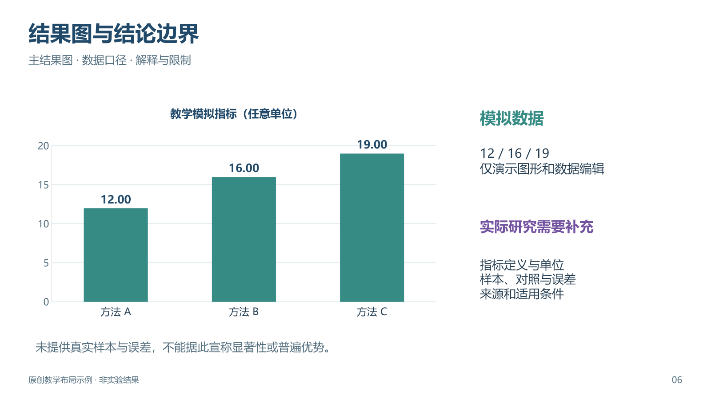
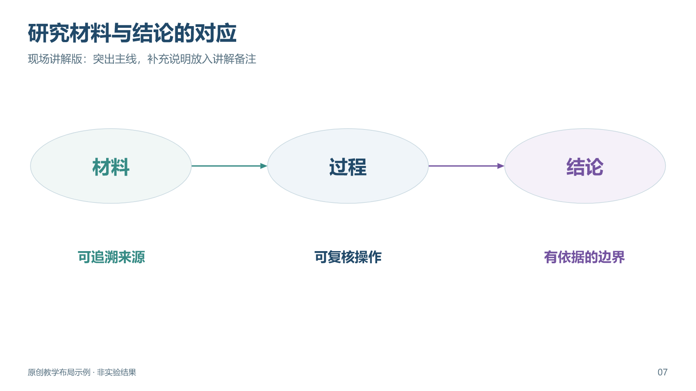
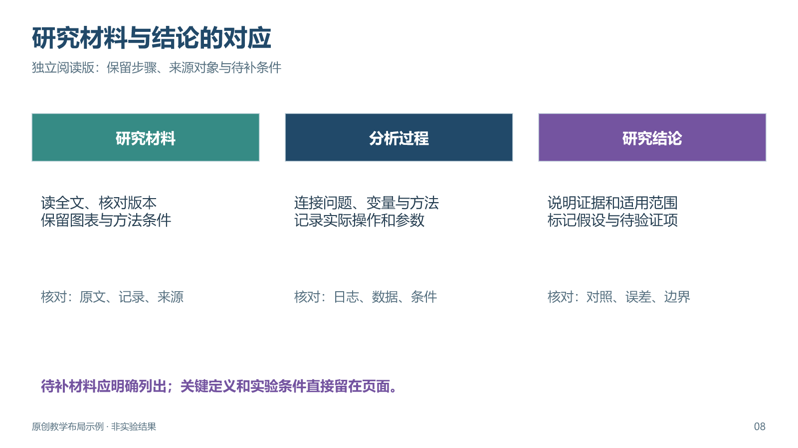

# 原创示例图库

这里提供16:9原创版式。教学样页不包含真实实验结果；具体课题须替换对象、步骤和证据。PNG用于查看，PPTX保留独立文字、箭头、表格与图表；旧版SVG仍保留。

## 第二版可编辑样页

[下载8页样页库](../templates/academic-layouts-v2.0.pptx)。前6页对应不同科研关系，最后两页比较同一主线的信息密度。各页均有讲解备注。

| 页 | 版式 | 合适的内容 | 修改时检查 |
| --- | --- | --- | --- |
| 1 | 中心机制 | 核心判断与多类支撑 | 虚线表示支撑，不能暗示因果 |
| 2 | 双侧协同 | 材料设计与应用验证 | 两侧对象在共同目标下对应，反馈有实际依据 |
| 3 | 分层路线 | 材料、方法、证据、结论 | 横向步骤和跨层推进分清 |
| 4 | 实验设计 | 变量、对照、测量与评价 | 补真实样本、重复、时间与单位 |
| 5 | 验证矩阵 | 问题与不同证据的对应 | 写证据位置，不能凭模板填“已通过” |
| 6 | 结果页 | 主结果、数据口径与边界 | 12/16/19为模拟值，必须替换或标为教学 |
| 7–8 | 密度对照 | 现场讲解与独立阅读 | 两版保留同一研究主线，关键条件留正文 |

## 第一版SVG样图

## 01 研究问题与证据框架

- 用途：介绍一个研究问题如何得到材料、方法、执行与验证的支撑。
- 布局：中心问题，两侧输入与证据，中部方法，下部执行与反馈。
- 配色：深蓝承担核心对象，青绿区分材料与执行，紫色区分证据与验证。
- 借鉴点：同时表达支撑关系和验证回路，详细小项仍可独立阅读。
- 调整：不要照搬模块数；没有反馈验证就不画回路。真实证据图可以替换相应模块。

## 02 从材料到可复核产出

- 用途：科研软件、AI辅助研究、数据分析或教学演示中的操作链。
- 布局：四段横向过程，每段有输入、动作与产出；底部设置相应复核。
- 配色：深蓝标识步骤，青绿表示输出，浅紫表示质量检查。
- 借鉴点：每个工具都连接具体对象和可见交付，便于讲清实际工作。
- 调整：步骤和文件名必须按真实任务填写，示意流程不能冒充已执行记录。

## 03 论文修改的前后对照

- 用途：审稿回复、导师意见落实、段落或图表修改说明。
- 布局：上部意见与动作，下部同一对象的原文和修订稿，底部证据与待补项。
- 配色：灰蓝表示原文，青绿表示修订，紫色表示核验边界。
- 借鉴点：清楚展示改了哪里、为何修改、还缺什么，读者能对照同一对象。
- 调整：示例文字是虚构教学文本；实际内容替换为真实原文与修改后文本。

新参考图优先于这些默认样例。私人图库可放在本地 `gallery-local/` 中，该目录被版本控制忽略；其中内容不会自动成为公开可发布素材。
