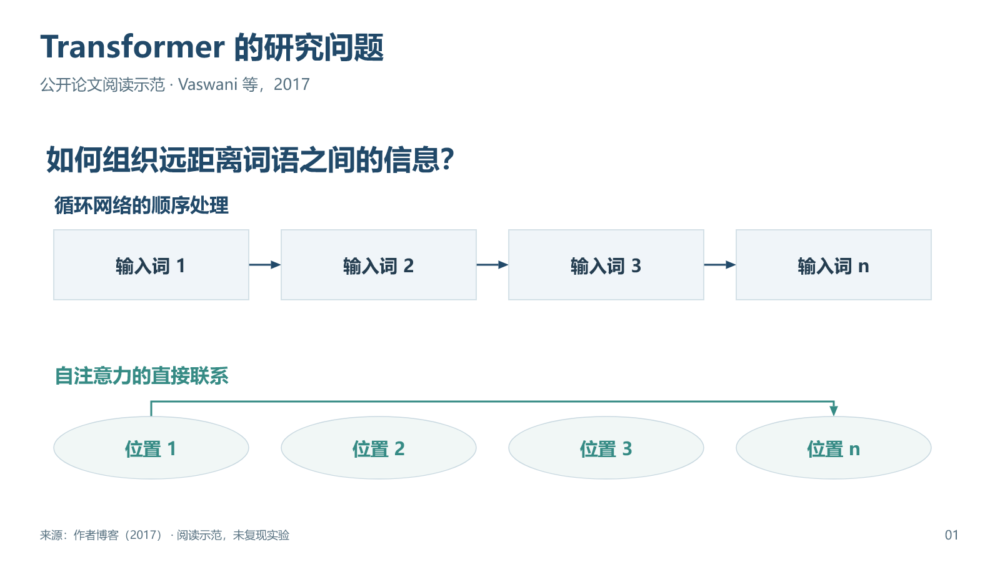
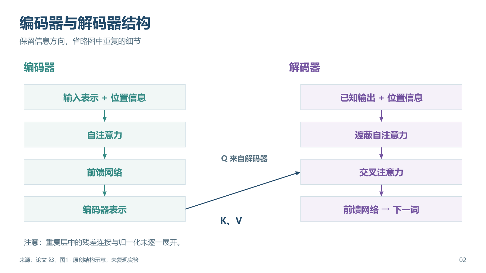
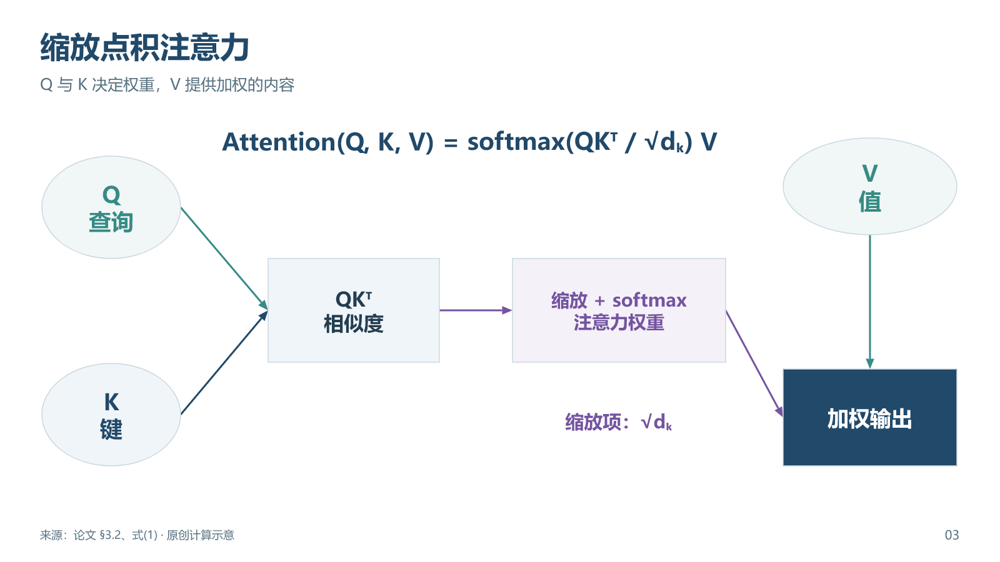
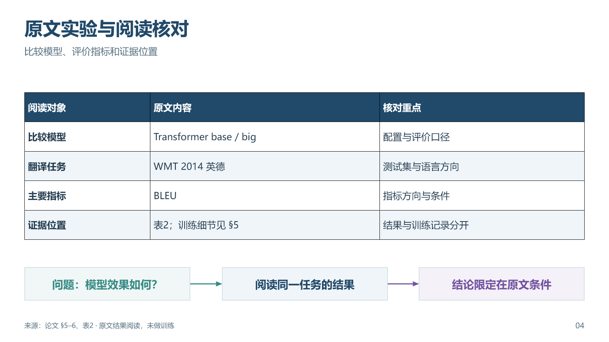
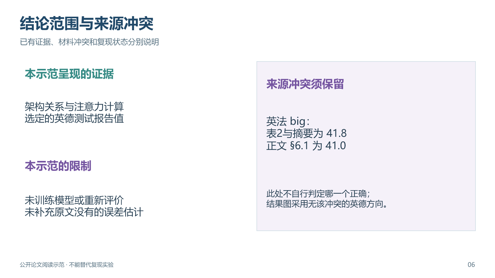

# 公开论文阅读示范

以 Vaswani 等人的 *Attention Is All You Need*（2017）为例，演示研究问题、结构、机制、实验阅读、结果与限制的对应。使用 [论文全文](https://arxiv.org/pdf/1706.03762) 与 [作者博客](https://research.google/blog/transformer-a-novel-neural-network-architecture-for-language-understanding/)，查阅日期为2026-10-10。论文页面显示arXiv v7（2023-08-02）；原作发表于2017年。

[下载六页可编辑示范](transformer-reading-example-v2.pptx)。每页有来源和讲解备注，关系图为原创简化示意。这里只阅读原文，没有训练、重新评价模型或验证复现。

| 页 | 解释任务 | 来源位置 | 保留的边界 |
| --- | --- | --- | --- |
| 1 | 研究问题与信息联系 | 作者博客 | 连线为概念示意，不是真实权重 |
| 2 | 编码器与解码器分工 | 论文§3、图1 | 未展开重复层的残差连接与归一化 |
| 3 | 注意力的计算依赖 | 论文§3.2、式(1) | 无模拟或实测注意力权重 |
| 4 | 比较条件与评价对象 | 论文§5–6、表2 | 只记录原文实验口径 |
| 5 | 三个英德报告值 | 论文表2 | BLEU 25.16、27.3、28.4；未估计显著性 |
| 6 | 结论范围与来源冲突 | 论文摘要、§6.1、表2 | 英法big：表与摘要41.8，正文41.0；不擅自消除差异 |

结果图选用英德方向，未把英法冲突数值带入图表。这里比较的是三个选定模型，不能据此推断所有模型、任务或现今技术的排序。

预览图用于查看实际导出的页面，编辑请使用PPTX。

